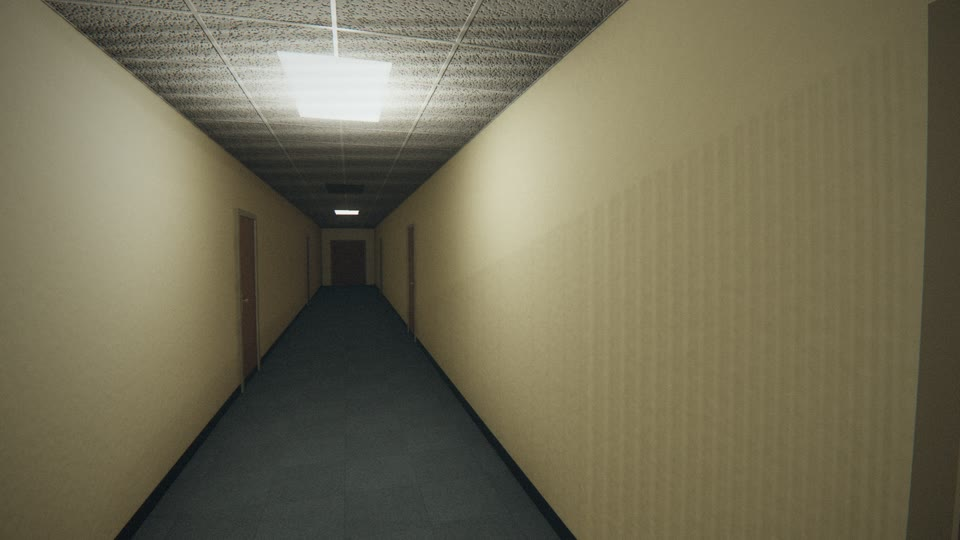
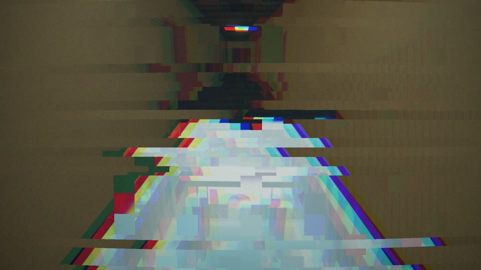
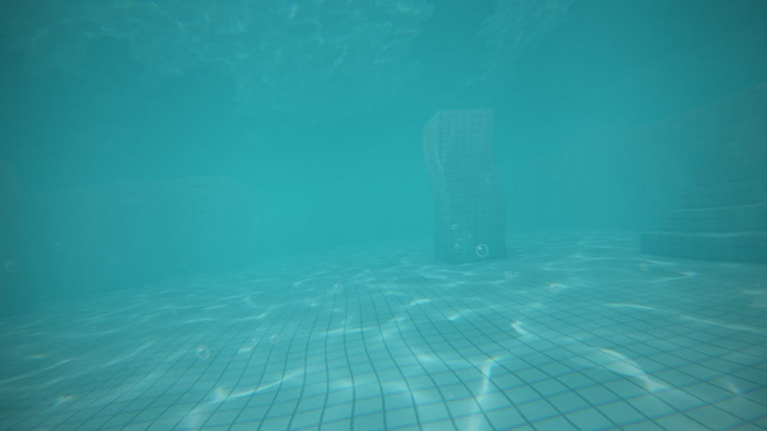
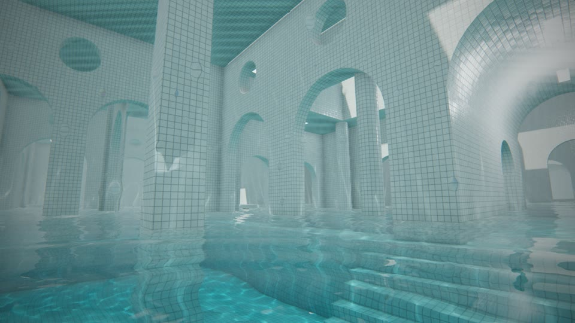
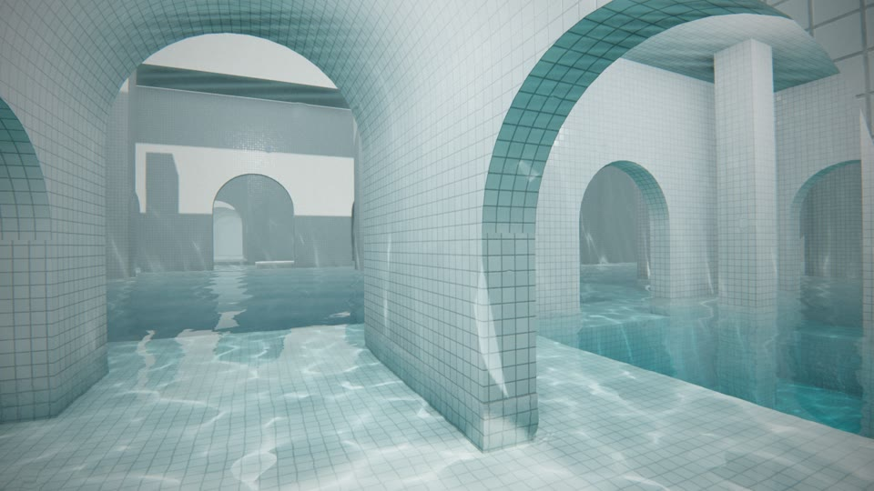
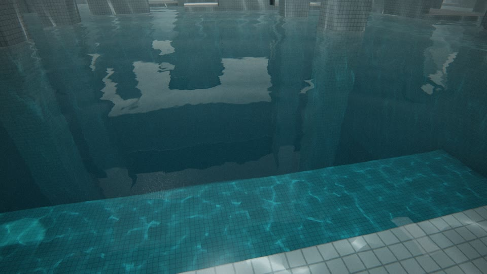

# claude-lab.2

A sandbox repository for testing Claude Code, exploring AI-assisted programming, automation, debugging, and development workflows.

---

# BACKROOMS — What if you fell into the Pool Rooms?

Curta de terror psicológico em primeira pessoa (POV / found footage), **20 segundos exatos, 1920×1080, 60 fps**,
gerado inteiramente por código: **Three.js** (cena 3D, shaders, PBR), **GSAP** (linha do tempo e câmera) e
**FFmpeg** (frames → MP4). Nenhum asset externo: geometria, texturas, cáusticas e a trilha sonora são procedurais.

**Resultado final:** [`Backrooms_PoolRooms.mp4`](Backrooms_PoolRooms.mp4)

| | |
|---|---|
|  |  |
|  |  |
|  |  |

## Roteiro (linha do tempo em `src/timeline.js`)

| Tempo | Bloco | O que acontece |
|---|---|---|
| 0 – 4 s | **O noclip** | Caminhada por um corredor comum (carpete, portas, forro, fluorescentes). As lâmpadas falham, os ladrilhos do piso somem um a um revelando o complexo de piscinas lá embaixo, a câmera atravessa o chão, vê o corredor "por fora" e despenca no vazio. |
| 4 – 8 s | **A chegada** | Impacto na água, ~1 s submerso (cáusticas, bolhas, janela de Snell), a lente cruza a linha d'água e a câmera emerge devagar girando pelo salão: paredes altas, arcadas, escotilhas, escada cromada, poço de luz. |
| 8 – 13 s | **A exploração** | Sobe a escadaria submersa, entra no corredor abobadado parcialmente inundado, espia as piscinas laterais (degraus que descem para a água, colunas, passagens que somem na névoa). |
| 13 – 17 s | **Algo está errado** | As luzes piscam, a casa de máquinas morre, uma sombra enorme desliza sob a superfície; a câmera para na borda do abismo e encara o fundo. |
| 17 – 20 s | **O final** | Blecaute; quando a luz volta há uma silhueta humanoide parada no fundo. Zoom nervoso, ela começa a subir, novo blecaute — agora está na borda, saindo da água que ferve. Recuo em pânico e **corte seco para preto em 19,0 s** (último segundo preto e em silêncio). |

## Como reproduzir

```bash
npm install            # three + gsap (+ playwright para a captura)
npm run build          # áudio -> frames -> MP4   (equivale aos três comandos abaixo)

npm run audio          # sintetiza build/audio.wav
npm run frames         # captura 1200 frames em build/frames/ (retomável)
npm run encode         # FFmpeg -> Backrooms_PoolRooms.mp4
```

Requisitos: Node 20+, FFmpeg com libx264 e um Chromium (o Playwright instala o dele com `npx playwright install chromium`;
ou aponte `CHROMIUM_PATH` para um Chrome existente).

Outros comandos úteis:

```bash
npm run dev                                           # preview em tempo real em http://localhost:5173 (precisa de GPU)
npm run stills -- --times 6,10.5,17.4 --scale 0.5     # frames avulsos em build/stills/
node scripts/render.mjs --scale 0.25 --step 2 --out build/preview    # prévia rápida (480×270, 30 fps)
node scripts/encode.mjs --frames build/preview --step 2 --out build/preview.mp4
node scripts/render.mjs --from 1020 --to 1140 --force # refaz só um trecho
USE_GPU=1 npm run frames                              # usa a GPU em vez do rasterizador por software
```

> A captura foi feita em Chromium *headless* com WebGL por software (SwiftShader): ~3 s por frame, cerca de 1 h para
> o filme inteiro em 4 núcleos. Com GPU o mesmo código roda em tempo real.

## Como funciona

**Determinismo.** Tudo é função pura do tempo: a timeline GSAP fica pausada e é posicionada em `t = frame / 60`
a cada quadro; ruído de câmera, partículas, ondas e piscadas usam *hashes* determinísticos. Por isso qualquer frame pode
ser renderizado isoladamente, em paralelo, e uma captura interrompida continua de onde parou.

**Cenário (`src/scene`).**
- `builder.js` — kit de arquitetura: caixas, paredes com arcos/escotilhas (triangulação com furos), abóbadas, colunas, escadas.
- `poolrooms.js` — o set principal (salão de chegada, corredor inundado, duas piscinas laterais, galeria superior, salão
  profundo com terraço e abismo) cercado por um campo procedural de vãos repetidos (instanciado) que se perde na névoa.
- `corridor.js` — o corredor "normal", suspenso exatamente acima do salão: quando o piso falha, as piscinas estão de fato lá embaixo.
- `textures.js` — azulejo cerâmico (albedo/normal/ORM com bisel, rejunte e inclinação por peça), carpete, pintura, forro,
  madeira; campo de ondas e **cáusticas reais por *photon splatting*** através desse campo.
- `materials.js` — `MeshStandardMaterial` (GGX + IBL + sombras) estendido via `onBeforeCompile`: UV projetado em espaço de
  mundo (a malha de azulejos é contínua em todo o complexo), variação por peça sem repetição, faixa molhada na linha
  d'água, absorção com a profundidade, cáusticas abaixo e reflexos de cáustica acima da água, luz ambiente hemisférica
  e névoa próprias por "mundo", e a falha de realidade do piso do corredor.
- `water.js` — shader da água: reflexo planar (câmera espelhada com plano de corte oblíquo), refração em espaço de tela,
  absorção/espalhamento de Beer-Lambert pelo caminho óptico real, Fresnel, marolas + anéis de onda emitidos em cada
  passo/mergulho, espuma, modo "fervendo" do final; vista de baixo com janela de Snell e reflexão interna total.
- `entity.js`, `particles.js` — a sombra, a silhueta, bolhas, respingos e as estrias do vazio.

**Iluminação.** Uma luz-chave direcional entra pelos poços de luz do teto (mapa de sombras 8192², renderizado uma única vez,
PCF suave), painéis emissivos HDR, luzes pontuais de preenchimento, *environment maps* PMREM capturados da própria cena
(um para as piscinas, outro para o corredor) e oclusão de ambiente em espaço de tela.

**Pós-processamento (`src/post/pipeline.js`).** opaco (MSAA 4×, HDR) → SSAO → reflexo → água → *bloom* → "câmera":
distorção de barril, aberração cromática, linha d'água na lente (menisco + névoa subaquática por profundidade), gotas na
lente, *glitch* digital, *zoom blur*, curva fílmica ACES, vinheta e ruído de sensor. Sem HUD.

**Câmera (`src/timeline.js`).** Posição, guinada/arfagem/rolagem, FOV, tremor e todos os efeitos são *tweens* GSAP em um
único `gsap.timeline`. Por cima entram, de forma procedural, o balanço dos passos (sincronizado com a distância
percorrida), o gingado de quem anda com água pelo joelho, o boiar, a respiração e o tremor de mão que cresce com o medo.

**Som (`scripts/audio.mjs`).** Sintetizado do zero em Node e travado na mesma timeline e nas mesmas curvas de piscada da
imagem: zumbido de reator e passos no carpete, *glitch*, vento da queda, impacto, pressão e bolhas debaixo d'água,
respiração ofegante, marolas, goteiras, zumbido e estalos das lâmpadas, *drone*, a passagem da sombra, coração, o susto
e o corte seco. Dois reverbs por convolução FFT com respostas ao impulso sintéticas (corredor seco / salão azulejado enorme).

## Estrutura

```
index.html              página hospedeira (preview e captura)
src/config.js           resolução, fps, duração, constantes de cena
src/timeline.js         linha do tempo GSAP + rig da câmera
src/main.js             montagem da cena e API de frames (window.__renderFrame)
src/scene/*             geometria, materiais, água, entidades, partículas
src/post/pipeline.js    passes de render e pós-processamento
src/shared/*            matemática determinística e curvas de piscada (imagem + som)
scripts/render.mjs      captura automatizada dos frames (Playwright)
scripts/audio.mjs       sintetizador da trilha
scripts/encode.mjs      FFmpeg: frames + WAV -> MP4 (H.264 High, yuv420p, AAC)
scripts/stills.mjs      frames avulsos · bench.mjs / profile.mjs: medição de desempenho
```
